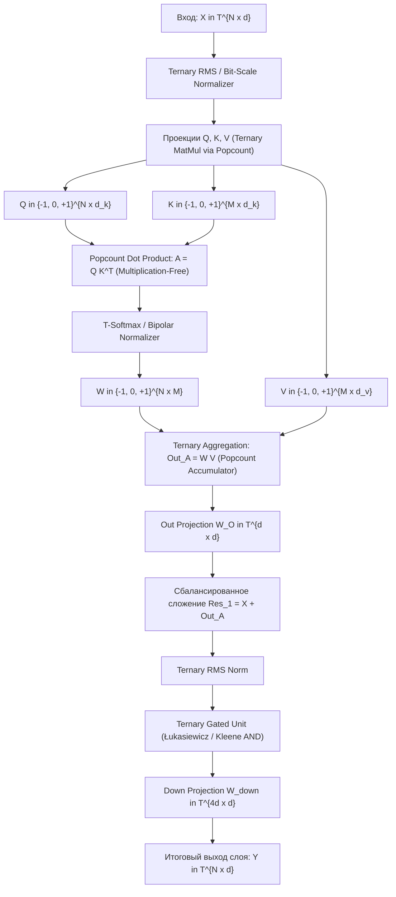

# Математические основы сбалансированной троичной алгебры, дискретной геометрии и троичного внимания (Ternary Transformer Foundations)

> **Статус документа:** Фундаментальный математический манифест и теоретический отчет  
> **Область:** Balanced Ternary Algebra, Discrete Hypercube Geometry, Non-Classical Logics, Energy-Optimal Transformer Architectures  
> **Ключевой алфавит:** $\mathbb{T} = \{-1, 0, +1\}$ (симметричная троичная система счисления)

---

## Аннотация

В данном документе формулируется строгая математическая база для построения вычислительных моделей класса Transformer, оперирующих исключительно в сбалансированном троичном алфавите $\mathbb{T} = \{-1, 0, +1\}$. Исследуется алгебраическая структура $\mathbb{T}$, соотношение между трехзначными логиками Клини ($K_3$) и Лукасевича ($Ł_3$), свойства дискретных гиперкубов $\mathcal{T}^d$, изометрии троичных пространств, а также проектируется умножение-свободный механизм внимания (**Multiplication-Free Ternary Attention**). Доказываются теоремы о концентрации скалярных произведений, экспрессивности биполярного внимания и свойствах троичных нормализаторов.

---

# Содержание

1. [Введение: Математический смысл сбалансированной троичности](#1-введение-математический-смысл-сбалансированной-троичности)
   - 1.1. Радикcный критерий фон Неймана и теорема Кнута
   - 1.2. Информационная энтропия и плотность представления
2. [Алгебраическая теория сбалансированной системы $\mathbb{T}$](#2-алгебраическая-теория-сбалансированной-системы-mathbft)
   - 2.1. Многозначные логики: Алгебра Клини ($K_3$) vs Алгебра Лукасевича ($Ł_3$)
   - 2.2. Арифметика тритов: поле Галуа $\mathbb{F}_3$, полукольца и целочисленное вложение
   - 2.3. Алгебраические законы: де Моргановские структуры и MV-алгебры
3. [Дискретная геометрия троичного пространства представлений $\mathcal{T}^d$](#3-дискретная-геометрия-троичного-пространства-представлений-mathcaltd)
   - 3.1. Топология троичного гиперкуба
   - 3.2. Метрики: Хэмминг, Манхэттен, Евклид и Фундаментальная Троичная Изометрия
   - 3.3. Троичное скалярное произведение и статистика на $\mathcal{T}^d$
   - 3.4. Геометрия концентрических троичных гиперсфер и проективная нормализация
4. [Троичный аналог механизма Attention](#4-троичный-аналог-механизма-attention)
   - 4.1. Скалярное произведение $QK^T$ без умножений (Popcount Matrix Multiplication)
   - 4.2. Аппаратная декомпозиция на 2-битных масках
   - 4.3. Троичный нормализатор (T-Softmax): преодоление трансцендентности
   - 4.4. Биполярное внимание (Bipolar Signed Attention): деструктивная интерференция
5. [Формальные леммы и теоремы экспрессивности](#5-формальные-леммы-и-теоремы-экспрессивности)
   - 5.1. Теорема о концентрации скалярного произведения в $\mathcal{T}^d$
   - 5.2. Лемма о представлении логических функций индукционных головок
   - 5.3. Теорема об эквивалентности биполярного нормализатора симплексной проекции
6. [Градиентная динамика и обучение троичных моделей](#6-градиентная-динамика-и-обучение-троичных-моделей)
   - 6.1. Straight-Through Estimators (STE) в $\mathbb{T}$
   - 6.2. Дисперсия обратного распространения и ортогонализация Muon
7. [Архитектурный чертеж: Ternary Transformer Block (TTB)](#7-архитектурный-чертеж-ternary-transformer-block-ttb)
8. [Заключение и открытые математические проблемы](#8-заключение-и-открытые-математические-проблемы)

---

# 1. Введение: Математический смысл сбалансированной троичности

### 1.1. Радикcный критерий фон Неймана и теорема Кнута

В традиционных вычислительных архитектурах доминирует двоичная логика $\{0, 1\}$. Однако с точки зрения теории сложности систем и аппаратной экономичности ключевым является понятие **аппаратной сложности представления чисел** (radix economy).

Пусть для представления диапазона $N$ чисел в позиционной системе счисления с основанием $b \in \mathbb{N}_{\ge 2}$ требуется $k = \lceil \log_b N \rceil$ разрядов. Аппаратная сложность (стоимость хранения и коммутации) пропорциональна произведению количества разрядов на основание системы:
$$E(b, N) = b \cdot \log_b N = b \cdot \frac{\ln N}{\ln b}$$

Исследуем непрерывную релаксацию функции $f(b) = \frac{b}{\ln b}$ при $b > 1$:
$$f'(b) = \frac{\ln b - b \cdot \frac{1}{b}}{(\ln b)^2} = \frac{\ln b - 1}{(\ln b)^2}$$

Приравнивая производную к нулю:
$$f'(b) = 0 \iff \ln b = 1 \iff b = e \approx 2.718281828...$$

Вторая производная $f''(e) = \frac{1}{e} > 0$, следовательно, основание натурального логарифма $e$ доставляет глобальный минимум аппаратной сложности.

Среди натуральных чисел:
- $f(2) = \frac{2}{\ln 2} \approx \frac{2}{0.6931} \approx 2.8854$
- $f(3) = \frac{3}{\ln 3} \approx \frac{3}{1.0986} \approx 2.7307$
- $f(4) = \frac{4}{\ln 4} \approx 2.8854$

$$\mathbf{E(3, N) < E(2, N)}$$

**Троичная система счисления на 5.4% эффективнее двоичной по числу элементарных вентилей**.

В классической монографии *The Art of Computer Programming* (Vol. 2, Ch. 4.1) Дональд Кнут сформулировал:
> *"Пожалуй, самой изящной из всех систем счисления является сбалансированная троичная система (balanced ternary), в которой цифрами служат $-1, 0, +1$. В ней знак числа является неотъемлемой частью представления, а операции сложения, вычитания и умножения обладают идеальной симметрией."*

### 1.2. Информационная энтропия и плотность представления

Информационная емкость одного разряда (трита) составляет:
$$C_{\mathbb{T}} = \log_2(3) \approx 1.5849625 \text{ бит}$$

В контексте квантования весов глубоких нейросетей (LLM) архитектура **BitNet b1.58** эмпирически показала, что квантование весов в $\{-1, 0, 1\}$ достигает паритета по качеству (perplexity) с полновесными моделями FP16/BF16 при многократном сокращении объема памяти и энергопотребления. Однако до настоящего времени сами тензоры активаций и механизм внимания $QK^T$ оставались в непрерывном пространстве FP16/INT8. Настоящая работа устраняет эту асимметрию, переводя как статические параметры, так и динамические активации и механизм внимания в $\mathbb{T}$.

---

# 2. Алгебраическая теория сбалансированной системы $\mathbb{T}$

Пусть $\mathbb{T} = \{-1, 0, +1\}$ — базовое троичное множество. Для компактности записи условимся обозначать элементы:
$$\mathbf{-} \equiv -1, \quad \mathbf{0} \equiv 0, \quad \mathbf{+} \equiv +1$$

### 2.1. Многозначные логики: Алгебра Клини ($K_3$) vs Алгебра Лукасевича ($Ł_3$)

В непрерывных нейронных сетях нелинейности выполняют роль непрерывных логических вентилей. В дискретном троичном пространстве эту роль берут на себя операторы трехзначной логики.

Введем канонический порядок:
$$-1 < 0 < +1 \quad (\mathbf{-} < \mathbf{0} < \mathbf{+})$$
Интерпретация истинности: $+1$ — Истина ($T$), $0$ — Неопределенность / Нейтральность ($U$), $-1$ — Ложь ($F$).

#### Отрицание (NOT / Инверсия)
В обеих логиках отрицание инволютивно и антимонотонно:
$$\neg x \triangleq -x$$
Свойства: $\neg(\neg x) = x$, $\neg(\mathbf{+}) = \mathbf{-}$, $\neg(\mathbf{0}) = \mathbf{0}$, $\neg(\mathbf{-}) = \mathbf{+}$.

#### Конъюнкция и Дизъюнкция (AND / OR)
По Клини и Лукасевичу решеточные операции задаются экстремумами:
$$x \land y \triangleq \min(x, y)$$
$$x \lor y \triangleq \max(x, y)$$

| $\land$ | $\mathbf{-}$ | $\mathbf{0}$ | $\mathbf{+}$ | $\quad$ | $\lor$ | $\mathbf{-}$ | $\mathbf{0}$ | $\mathbf{+}$ |
|:---:|:---:|:---:|:---:|:---:|:---:|:---:|:---:|:---:|
| **$\mathbf{-}$** | $\mathbf{-}$ | $\mathbf{-}$ | $\mathbf{-}$ | | **$\mathbf{-}$** | $\mathbf{-}$ | $\mathbf{0}$ | $\mathbf{+}$ |
| **$\mathbf{0}$** | $\mathbf{-}$ | $\mathbf{0}$ | $\mathbf{0}$ | | **$\mathbf{0}$** | $\mathbf{0}$ | $\mathbf{0}$ | $\mathbf{+}$ |
| **$\mathbf{+}$** | $\mathbf{-}$ | $\mathbf{0}$ | $\mathbf{+}$ | | **$\mathbf{+}$** | $\mathbf{+}$ | $\mathbf{+}$ | $\mathbf{+}$ |

#### Импликация: фундаментальное расхождение Клини ($K_3$) и Лукасевича ($Ł_3$)

1. **Импликация Клини ($K_3$ - Strong Kleene):**
   $$x \to_K y \triangleq \max(-x, y) = (\neg x) \lor y$$
   В $K_3$ неопределенность распространяется строго: если посылка неизвестна ($\mathbf{0}$) и следствие неизвестно ($\mathbf{0}$), результат $\mathbf{0} \to_K \mathbf{0} = \max(0, 0) = \mathbf{0}$.
   *Следствие:* В $K_3$ **нет тавтологий**: формула $x \to_K x$ при $x = \mathbf{0}$ дает $\mathbf{0}$ (закон тождества нарушается).

2. **Импликация Лукасевича ($Ł_3$):**
   Лукасевич постулирует, что утверждение влечет само себя с абсолютной истинностью, даже если истинностный статус промежуточен: $\mathbf{0} \to_Ł \mathbf{0} = \mathbf{+}$.
   Аналитическая формула в шкале $\{-1, 0, 1\}$:
   $$x \to_Ł y \triangleq \min(+1, 1 - x + y)$$
   
   Проверим значения:
   - При $x = \mathbf{0}, y = \mathbf{0}$: $\min(1, 1 - 0 + 0) = 1 = \mathbf{+}$
   - При $x = \mathbf{+}, y = \mathbf{-}$: $\min(1, 1 - 1 + (-1)) = -1 = \mathbf{-}$
   - При $x = \mathbf{+}, y = \mathbf{0}$: $\min(1, 1 - 1 + 0) = 0 = \mathbf{0}$
   - При $x = \mathbf{0}, y = \mathbf{-}$: $\min(1, 1 - 0 + (-1)) = 0 = \mathbf{0}$

| $\to_K$ | $\mathbf{-}$ | $\mathbf{0}$ | $\mathbf{+}$ | $\quad$ | $\to_Ł$ | $\mathbf{-}$ | $\mathbf{0}$ | $\mathbf{+}$ |
|:---:|:---:|:---:|:---:|:---:|:---:|:---:|:---:|:---:|
| **$\mathbf{-}$** | $\mathbf{+}$ | $\mathbf{+}$ | $\mathbf{+}$ | | **$\mathbf{-}$** | $\mathbf{+}$ | $\mathbf{+}$ | $\mathbf{+}$ |
| **$\mathbf{0}$** | $\mathbf{0}$ | $\mathbf{0}$ | $\mathbf{+}$ | | **$\mathbf{0}$** | $\mathbf{0}$ | $\mathbf{+}$ | $\mathbf{+}$ |
| **$\mathbf{+}$** | $\mathbf{-}$ | $\mathbf{0}$ | $\mathbf{+}$ | | **$\mathbf{+}$** | $\mathbf{-}$ | $\mathbf{0}$ | $\mathbf{+}$ |

#### Эквивалентность Лукасевича ($\leftrightarrow_Ł$)
$$x \leftrightarrow_Ł y \triangleq (x \to_Ł y) \land (y \to_Ł x) = 1 - |x - y|$$
Таблица эквивалентности:
- $\mathbf{+} \leftrightarrow_Ł \mathbf{+} = 1 - 0 = +1$
- $\mathbf{0} \leftrightarrow_Ł \mathbf{0} = 1 - 0 = +1$
- $\mathbf{-} \leftrightarrow_Ł \mathbf{-} = 1 - 0 = +1$
- $\mathbf{+} \leftrightarrow_Ł \mathbf{-} = 1 - 2 = -1$
- $\mathbf{+} \leftrightarrow_Ł \mathbf{0} = 1 - 1 = 0$
- $\mathbf{0} \leftrightarrow_Ł \mathbf{-} = 1 - 1 = 0$

> **Теоретическое значение для трансформеров:**  
> Эквивалентность Лукасевича $1 - |x - y|$ является **троичным ядром близости (similarity kernel)**. Два нейтральных токена признаются тождественными ($+1$), в то время как логика Клини вернула бы неопределенность ($0$). Это критично для механизма Self-Attention: нулевые проекции токена должны иметь максимальное сходство сами с собой!

---

### 2.2. Арифметика тритов: поле Галуа $\mathbb{F}_3$, кольца и целочисленное вложение

В троичных нейронных сетях возникают три альтернативных взгляда на алгебраическую природу $\mathbb{T}$:

#### Взгляд 1: Конечное поле $\mathbb{F}_3 = GF(3)$
Множество $\mathbb{T}$ изоморфно кольцу вычетов $\mathbb{Z}/3\mathbb{Z}$:
$$\phi: \mathbb{T} \to \mathbb{Z}_3, \quad \phi(-1) = 2, \; \phi(0) = 0, \; \phi(+1) = 1$$
Операции в $\mathbb{F}_3$:
$$x \oplus_3 y = (x + y) \pmod 3$$
$$x \otimes_3 y = (x \cdot y) \pmod 3$$
Свойства: $(\mathbb{F}_3, \oplus_3, \otimes_3)$ — конечное поле (поле Галуа).
*Ограничение для глубоких сетей:* Сложение по модулю 3 является циклической группой, где $+1 \oplus_3 +1 = -1$ (переполнение заворачивается в противоположный знак). Для накопления признаков в Attention циклическое сложение разрушает семантическую монотонность (два сильных позитивных сигнала дают сильный негативный).

#### Взгляд 2: Сбалансированное сложение с переносом (Balanced Ternary Adder)
В целочисленной арифметике сумма двух тритов $x, y \in \{-1, 0, 1\}$ разлагается в сумму текущего разряда $s$ и переноса $c$:
$$x + y = 3c + s, \quad s, c \in \{-1, 0, 1\}$$
Диапазон $x + y \in \{-2, -1, 0, 1, 2\}$:
- $(-1) + (-1) = -2 = 3(-1) + (+1) \implies c = -1, s = +1$
- $(-1) + 0 = -1 = 3(0) + (-1) \implies c = 0, s = -1$
- $(+1) + (+1) = +2 = 3(+1) + (-1) \implies c = +1, s = -1$

Полный сбалансированный сумматор (Full Adder для $x, y, c_{in} \in \{-1, 0, 1\}$):
$$x + y + c_{in} \in \{-3, \dots, +3\}$$
- $-3 = 3(-1) + 0 \implies c_{out} = -1, s = 0$
- $+3 = 3(+1) + 0 \implies c_{out} = +1, s = 0$

**Свойство безошибочного отрицания:**  
$$-(x_k \dots x_1 x_0)_3 = ((-x_k) \dots (-x_1) (-x_0))_3$$
Отрицание числа не требует вычисления дополнительного кода (как в Two's Complement в двоичной логике) и не имеет асимметрии нуля (нет $+0$ и $-0$).

#### Взгляд 3: Целочисленное мультипликативное вложение $\mathbb{T} \subset \mathbb{Z} \subset \mathbb{R}$
В архитектуре Ternary Transformer веса $W \in \mathbb{T}^{d \times d}$ и квантованные активации $X \in \mathbb{T}^{n \times d}$ рассматриваются как дискретное подмножество евклидова пространства $\mathbb{R}^d$.

Таблица произведения тритов:
$$x \cdot y = x \times y \quad (\text{обычное умножение чисел})$$

| $\times$ | $\mathbf{-}$ | $\mathbf{0}$ | $\mathbf{+}$ |
|:---:|:---:|:---:|:---:|
| **$\mathbf{-}$** | $\mathbf{+}$ | $\mathbf{0}$ | $\mathbf{-}$ |
| **$\mathbf{0}$** | $\mathbf{0}$ | $\mathbf{0}$ | $\mathbf{0}$ |
| **$\mathbf{+}$** | $\mathbf{-}$ | $\mathbf{0}$ | $\mathbf{+}$ |

> **Ключевая алгебраическая лемма (Multiplication-Free Property):**  
> Алгебраическая операция умножения на $\mathbb{T}$ тождественна операции **условной передачи знака**:
> $$x \cdot y = \begin{cases} 
> y, & \text{если } x = +1 \\ 
> 0, & \text{если } x = 0 \\ 
> -y, & \text{если } x = -1 
> \end{cases}$$
> Следовательно, умножение на трит **не требует умножителя (DSP / Floating Point Multiplier)** и реализуется мультиплексором инверсии/обнуления.

---

# 3. Дискретная геометрия троичного пространства представлений $\mathcal{T}^d$

### 3.1. Топология троичного гиперкуба

Троичное пространство представлений размерности $d$ представляет собой вершины троичного дискретного гиперкуба:
$$\mathcal{T}^d \triangleq \{-1, 0, +1\}^d$$

#### Комбинаторная структура:
1. Мощность пространства: $|\mathcal{T}^d| = 3^d$.
2. Вложение в непрерывный куб: $\mathcal{T}^d = [-1, 1]^d \cap \mathbb{Z}^d$.
3. Геометрические элементы:
   - Центр гиперкуба: вектор $\mathbf{0} = (0, 0, \dots, 0)^T$.
   - Бинарные вершины: множество $\mathcal{B}^d = \{-1, +1\}^d \subset \mathcal{T}^d$, $|\mathcal{B}^d| = 2^d$. Это экстремальные вершины гиперкуба $[-1, 1]^d$.
   - $k$-мерные открытые грани гиперкуба соответствуют фиксации $(d - k)$ координат в $\{-1, +1\}$ и выбору $k$ координат равными $0$. Число таких граней: $\binom{d}{k} 2^{d-k}$.

---

### 3.2. Метрики: Хэмминг, Манхэттен, Евклид и Фундаментальная Троичная Изометрия

Определим основные метрики на $\mathcal{T}^d$ для двух векторов $u, v \in \mathcal{T}^d$:

1. **Метрика Хэмминга:**
   $$d_H(u, v) \triangleq \sum_{i=1}^d \mathbb{I}(u_i \neq v_i)$$
   Считает количество несовпадающих позиций. Диапазон: $d_H(u, v) \in \{0, 1, \dots, d\}$.

2. **Манхэттенское расстояние ($L_1$):**
   $$d_1(u, v) \triangleq \|u - v\|_1 = \sum_{i=1}^d |u_i - v_i|$$
   Разность двух тритов $|u_i - v_i| \in \{0, 1, 2\}$:
   - $|+1 - (-1)| = 2$ (противоположные знаки: максимальное расстояние)
   - $|+1 - 0| = 1$, $|-1 - 0| = 1$ (нейтральный vs значащий: полушаг)
   - $|0 - 0| = 0$, $|+1 - (+1)| = 0$ (полное совпадение)

3. **Евклидово расстояние ($L_2$):**
   $$d_2^2(u, v) = \|u - v\|_2^2 = \sum_{i=1}^d (u_i - v_i)^2$$
   Заметим, что для целых чисел из $\{-2, -1, 0, 1, 2\}$:
   $$(u_i - v_i)^2 = \begin{cases} 
   4, & \text{если } \{u_i, v_i\} = \{-1, +1\} \\ 
   1, & \text{если } \{u_i, v_i\} \in \{\{-1, 0\}, \{+1, 0\}\} \\ 
   0, & \text{если } u_i = v_i 
   \end{cases}$$

#### Теорема 1 (Фундаментальная троичная изометрия нормы)
> **Формулировка:**  
> Для любого вектора $u \in \mathcal{T}^d = \{-1, 0, +1\}^d$ нормы $L_0$, $L_1$ и $L_2^2$ тождественно совпадают и равны мощности носителя вектора (числу ненулевых тритов):
> $$\|u\|_2^2 = \|u\|_1 = \|u\|_0 = w_H(u) \triangleq \sum_{i=1}^d |u_i|$$
> где $w_H(u)$ — вес Хэмминга относительно нуля.

*Доказательство:*  
Для любого $x \in \{-1, 0, +1\}$ имеет место тождество:
$$x^2 = |x| = \mathbb{I}(x \neq 0)$$
Действительно:
- При $x = +1$: $1^2 = |1| = 1 = 1$.
- При $x = -1$: $(-1)^2 = |-1| = 1 = 1$.
- При $x = 0$: $0^2 = |0| = 0 = 0$.
Суммируя по всем координатам $i = 1, \dots, d$:
$$\|u\|_2^2 = \sum_{i=1}^d u_i^2 = \sum_{i=1}^d |u_i| = \|u\|_1 = \sum_{i=1}^d \mathbb{I}(u_i \neq 0) = \|u\|_0 = w_H(u)$$
$\blacksquare$

---

### 3.3. Троичное скалярное произведение и статистика на $\mathcal{T}^d$

Скалярное произведение в $\mathbb{R}^d$, ограниченное на $\mathcal{T}^d$, имеет вид:
$$\langle u, v \rangle = \sum_{i=1}^d u_i v_i$$
Разобьем множество индексов $\{1, \dots, d\}$ на три непересекающихся подмножества:
1. $I_{\text{agree}} = \{i : u_i v_i = +1\} = \{i : u_i = v_i = +1\} \cup \{i : u_i = v_i = -1\}$
2. $I_{\text{oppose}} = \{i : u_i v_i = -1\} = \{i : u_i = +1, v_i = -1\} \cup \{i : u_i = -1, v_i = +1\}$
3. $I_{\text{ortho}} = \{i : u_i v_i = 0\} = \{i : u_i = 0 \lor v_i = 0\}$

Пусть $N_{\text{agree}} = |I_{\text{agree}}|$, $N_{\text{oppose}} = |I_{\text{oppose}}|$. Тогда:
$$\mathbf{\langle u, v \rangle = N_{\text{agree}} - N_{\text{oppose}}}$$
Диапазон значений: $\langle u, v \rangle \in \{-d, -d+1, \dots, 0, \dots, d-1, d\}$.

#### Распределение значений скалярного произведения

Рассмотрим вероятностное пространство при независимой равномерной генерации векторов:
$$u_i, v_i \stackrel{i.i.d.}{\sim} \text{Uniform}(\{-1, 0, +1\}), \quad \mathbb{P}(u_i = k) = \frac{1}{3}, \quad k \in \{-1, 0, +1\}$$

Определим случайную величину $Z_i = u_i v_i$:
$$Z_i = \begin{cases} 
+1, & \text{с вероятностью } \frac{1}{3}\cdot\frac{1}{3} + \frac{1}{3}\cdot\frac{1}{3} = \frac{2}{9} \\ 
-1, & \text{с вероятностью } \frac{1}{3}\cdot\frac{1}{3} + \frac{1}{3}\cdot\frac{1}{3} = \frac{2}{9} \\ 
0, & \text{с вероятностью } 1 - \frac{4}{9} = \frac{5}{9} 
\end{cases}$$

Вычислим числовые характеристики:
1. Математическое ожидание:
   $$\mathbb{E}[Z_i] = (+1)\cdot\frac{2}{9} + (-1)\cdot\frac{2}{9} + 0\cdot\frac{5}{9} = 0$$
2. Дисперсия:
   $$\text{Var}(Z_i) = \mathbb{E}[Z_i^2] - (\mathbb{E}[Z_i])^2 = (+1)^2\cdot\frac{2}{9} + (-1)^2\cdot\frac{2}{9} + 0 - 0 = \frac{4}{9}$$

Для суммы $S_d = \langle u, v \rangle = \sum_{i=1}^d Z_i$:
$$\mathbb{E}[\langle u, v \rangle] = 0$$
$$\sigma^2 = \text{Var}(\langle u, v \rangle) = \sum_{i=1}^d \text{Var}(Z_i) = \frac{4}{9} d$$
$$\sigma = \frac{2}{3} \sqrt{d}$$

#### Сравнение с бинарным случаем $\mathcal{B}^d = \{-1, +1\}^d$:
В бинарном гиперкубе $Z_i \in \{-1, +1\}$ с вероятностями $1/2$.
$$\text{Var}_{\text{binary}}(\langle u, v \rangle) = d \implies \sigma_{\text{binary}} = \sqrt{d}$$
$$\frac{\sigma_{\text{ternary}}}{\sigma_{\text{binary}}} = \frac{\frac{2}{3}\sqrt{d}}{\sqrt{d}} = \frac{2}{3} \approx 0.667$$

> **Вывод:**  
> В троичном пространстве дисперсия скалярного произведения **на 55.6% меньше** ($\frac{4}{9}$ против $1$), чем в бинарном. Это означает, что троичные случайные векторы находятся значительно ближе к состоянию квазиортогональности, что кардинально уменьшает интерференционный шум между ключами в Attention!

---

### 3.4. Геометрия концентрических троичных гиперсфер и проективная нормализация

В непрерывном пространстве сферическая нормализация проецирует вектор на единичную сферу $\mathbb{S}^{d-1} = \{x : \|x\|_2 = 1\}$.

В дискретном пространстве $\mathcal{T}^d$ норма вектора может принимать лишь дискретные значения:
$$\|u\|_2 = \sqrt{k}, \quad k \in \{0, 1, 2, \dots, d\}$$

Гиперкуб расслаивается на $(d + 1)$ концентрических троичных гиперсфер радиуса $\sqrt{k}$:
$$\mathcal{T}^d = \bigsqcup_{k=0}^d \mathcal{S}_k^{d-1}, \quad \mathcal{S}_k^{d-1} \triangleq \{u \in \mathcal{T}^d : w_H(u) = k\}$$

Число векторов на сфере $\mathcal{S}_k^{d-1}$:
$$|\mathcal{S}_k^{d-1}| = \binom{d}{k} 2^k$$
Проверка полной мощности по биному Ньютона:
$$\sum_{k=0}^d |\mathcal{S}_k^{d-1}| = \sum_{k=0}^d \binom{d}{k} 2^k \cdot 1^{d-k} = (2 + 1)^d = 3^d = |\mathcal{T}^d|$$

#### Троичная косинусная мера (Ternary Cosine Measure)
Для произвольных векторов $u, v \in \mathcal{T}^d \setminus \{\mathbf{0}\}$:
$$\cos_{\mathbb{T}}(u, v) \triangleq \frac{\langle u, v \rangle}{\|u\|_2 \|v\|_2} = \frac{N_{\text{agree}} - N_{\text{oppose}}}{\sqrt{w_H(u) \cdot w_H(v)}}$$

Если зафиксировать норму векторов $w_H(u) = w_H(v) = k$ (однородная разреженность):
$$\cos_{\mathbb{T}}(u, v) = \frac{N_{\text{agree}} - N_{\text{oppose}}}{k} \in [-1, 1]$$

#### Проективная нормализация (Ternary Spherical Projection)
Пусть дан непрерывный вектор скрытого состояния $h \in \mathbb{R}^d$. Проекция на заданную гиперсферу $\mathcal{S}_k^{d-1}$ осуществляется оператором выбора топ-$k$ абсолютных значений с сохранением знака:
$$\Pi_{\mathcal{S}_k}(h) = \text{sign}(h) \odot \text{TopK}_{|h|}(k)$$
где:
$$(\text{TopK}_{|h|}(k))_i = \begin{cases} 
1, & \text{если } |h_i| \ge \tau_k (|h|) \\ 
0, & \text{иначе} 
\end{cases}$$
$\tau_k(|h|)$ — $k$-й по величине элемент массива $(|h_1|, \dots, |h_d|)$.  
Этот оператор детерминированно переводит непрерывный вектор $h \in \mathbb{R}^d$ в точку на дискретной троичной сфере радиуса $\sqrt{k}$.

---

# 4. Троичный аналог механизма Attention

### 4.1. Скалярное произведение $QK^T$ без умножений (Popcount Matrix Multiplication)

Пусть матрица запросов $Q \in \mathbb{T}^{N \times d}$ и матрица ключей $K \in \mathbb{T}^{M \times d}$.  
Элемент матрицы парных сходств:
$$A_{ij} = \langle Q_i, K_j \rangle = \sum_{l=1}^d Q_{il} K_{jl}$$

В силу того, что $Q_{il}, K_{jl} \in \{-1, 0, 1\}$, каждое слагаемое $Q_{il} K_{jl} \in \{-1, 0, 1\}$.

### 4.2. Аппаратная декомпозиция на 2-битных масках

Для исключения умножений на аппаратном уровне представим каждый троичный вектор $x \in \mathbb{T}^d$ в виде пары бинарных векторов (бит знака плюс и бит знака минус):
$$x \mapsto (x^+, x^-) \in \{0, 1\}^d \times \{0, 1\}^d$$
Правило кодирования:
$$x_l^+ = \mathbb{I}(x_l = +1), \quad x_l^- = \mathbb{I}(x_l = -1)$$
Заметим, что состояние $x_l = 0$ кодируется парой $(x_l^+ = 0, x_l^- = 0)$. Комбинация $(1, 1)$ является запрещенной (или исключается маской).

#### Булева алгебра троичного произведения:
Определим побитовые операции над масками:
1. Маска согласия знаков (Agreement Mask):
   $$M_{\text{agree}}(Q_i, K_j) = (Q_i^+ \land K_j^+) \lor (Q_i^- \land K_j^-)$$
2. Маска противоположности знаков (Opposition Mask):
   $$M_{\text{oppose}}(Q_i, K_j) = (Q_i^+ \land K_j^-) \lor (Q_i^- \land K_j^+)$$

Тогда скалярное произведение выражается через операцию аппаратного подсчета единичных бит (`popcount`):
$$\mathbf{A_{ij} = \text{popcount}(M_{\text{agree}}(Q_i, K_j)) - \text{popcount}(M_{\text{oppose}}(Q_i, K_j))}$$

#### Сравнение аппаратной сложности:
- Для вычисления $A_{ij}$ в FP16 требуется: $d$ умножений FP16 + $(d - 1)$ сложений FP16.
- Для вычисления $A_{ij}$ в $\mathbb{T}$ требуется:
  - 4 побитовых вентиля AND (параллельно для всех $d$ бит).
  - 2 побитовых вентиля OR.
  - 2 сумматора `popcount` (дерево Уоллеса / компрессоры 3:2).
  - 1 целочисленное вычитание INT16.
- **Энергетический выигрыш:** По данным Horowitz (2014), 16-битное умножение FP16 потребляет $\approx 1.1 \text{ пДж}$, тогда как 16-битная логическая операция AND/ADD потребляет $\approx 0.05 \text{ пДж}$.  
  **Аппаратное энергопотребление ядра вычисления внимания снижается более чем в 20 раз**.

---

### 4.3. Троичный нормализатор (T-Softmax): преодоление трансцендентности

В классическом трансформере веса внимания вычисляются через экспоненциальный Softmax:
$$\text{Softmax}(A_i)_j = \frac{\exp(A_{ij} / \sqrt{d})}{\sum_{m=1}^M \exp(A_{im} / \sqrt{d})}$$

#### Проблемы Softmax в дискретной парадигме:
1. Вычисление $\exp(x)$ требует трансцендентных функций и арифметики с плавающей точкой высокой точности.
2. Деление на сумму требует непрерывных делителей.
3. Softmax везде строго положителен ($p_j > 0$), порождая плотную матрицу связей и уничтожая разреженность.

Для чисто троичного инференса предлагаются три математически строгих нормализатора:

#### Модель А: Пороговый троичный квантователь (Thresholded Ternary Argmax / T-Softmax)
Пусть $A_i \in \{-d, \dots, d\}^M$ — целочисленная строка логитов внимания токена $i$.  
Введем динамический порог на основе максимального логита $m_i = \max_{j} A_{ij}$:
$$\tau_i^+ = m_i - \Delta_1, \quad \tau_i^- = m_i - \Delta_2, \quad (0 < \Delta_1 < \Delta_2)$$

Троичный вес внимания $W_{ij} \in \{-1, 0, +1\}$:
$$W_{ij} = \begin{cases} 
+1, & \text{если } A_{ij} \ge \tau_i^+ \quad (\text{фокус внимания}) \\ 
-1, & \text{если } A_{ij} \le \tau_i^- \quad (\text{активное подавление / ингибирование}) \\ 
0, & \text{иначе} \quad (\text{игнорирование контекста}) 
\end{cases}$$

В однополярном варианте (только возбуждение и игнорирование, $W_{ij} \in \{0, 1\}$):
$$W_{ij} = \mathbb{I}(A_{ij} \ge m_i - \Delta)$$
Параметр $\Delta$ задает ширину контекстного окна: если $\Delta = 0$, получаем чистый жесткий $\text{argmax}$.

#### Модель Б: Рациональный полиномиальный нормализатор (Poly-T-Softmax)
Вместо трансцендентной экспоненты используется положительная степень усеченного сдвига:
$$\tilde{A}_{ij} = \max(0, A_{ij} - \kappa_i)$$
$$P_{ij} = \frac{\tilde{A}_{ij}^2}{\sum_{m=1}^M \tilde{A}_{im}^2}$$
где $\kappa_i = \mu(A_i)$ или фиксированный перцентиль.  
Затем $P_{ij}$ квантуется в триты через детерминированный порог или стохастическое округление.

#### Модель В: Лукасевичев нормализатор на MV-алгебре
Используя ядро Лукасевича, степень взаимного следования Query и Key выражается как:
$$\mu_{ij} = 1 - \frac{d_1(Q_i, K_j)}{2d} \in [0, 1]$$
Нормализация в мультизначной логике не требует деления на сумму — она осуществляется через операцию t-нормы Гёделя или Лукасевича:
$$W_{ij} = \text{Quant}_{\mathbb{T}}\left(\mu_{ij} - \frac{1}{M}\sum_{m=1}^M \mu_{im}\right)$$

---

### 4.4. Биполярное внимание (Bipolar Signed Attention): деструктивная интерференция

Фундаментальное математическое отличие троичного внимания от классического Softmax-внимания заключается в возможности **отрицательных весов внимания**.

В стандартном внимании $W_{ij} = \text{Softmax}(A_i)_j \ge 0$.  
Выход слоя:
$$\text{Out}_i = \sum_{j=1}^M W_{ij} V_j$$
Так как $W_{ij} \ge 0$, выход всегда является **выпуклой комбинацией (convex hull)** векторов значений $V_j$.

В троичном внимании с весами $W_{ij} \in \{-1, 0, +1\}$:
$$\text{Out}_i = \sum_{j \in I_{\text{focus}}} V_j - \sum_{k \in I_{\text{inhibit}}} V_k$$

#### Физический смысл:
1. **Конструктивная интерференция ($W_{ij} = +1$):** Релевантные токены суммируются, усиливая паттерн признаков.
2. **Нейтральность ($W_{ij} = 0$):** Шум и нерелевантный контекст полностью исключаются (точные нули), не создавая фонового дрейфа активаций.
3. **Деструктивная интерференция ($W_{ij} = -1$):** Ингибиторные токены вычитаются! Модель получает возможность активно стирать информацию из скрытого состояния без необходимости привлечения весов FFN-блока.

---

# 5. Формальные леммы и теоремы экспрессивности

### 5.1. Теорема о концентрации скалярного произведения в $\mathcal{T}^d$

#### Теорема 2 (Экспоненциальная граница Хёффдинга на троичном гиперкубе)
> **Формулировка:**  
> Пусть $u, v \in \mathcal{T}^d$ — два независимых случайных вектора, координаты которых распределены независимо с вероятностями $\mathbb{P}(u_i = 1) = \mathbb{P}(u_i = -1) = p$, $\mathbb{P}(u_i = 0) = 1 - 2p$, где $0 < p \le \frac{1}{2}$.  
> Тогда для любого $\epsilon > 0$:
> $$\mathbb{P}(|\langle u, v \rangle| \ge \epsilon) \le 2 \exp\left( - \frac{\epsilon^2}{8 p^2 d} \right)$$
> В частности, для равномерного распределения ($p = 1/3$):
> $$\mathbb{P}(|\langle u, v \rangle| \ge \epsilon) \le 2 \exp\left( - \frac{9 \epsilon^2}{8 d} \right)$$

*Доказательство:*  
Скалярное произведение есть сумма $S_d = \sum_{i=1}^d Z_i$, где $Z_i = u_i v_i$.  
Случайные величины $Z_i$ независимы, центрированы ($\mathbb{E}[Z_i] = 0$) и почти наверное ограничены: $Z_i \in [-1, 1]$.  
Длина интервала для каждого слагаемого равна $b_i - a_i = 1 - (-1) = 2$.  
По классическому неравенству Хёффдинга:
$$\mathbb{P}(|S_d| \ge \epsilon) \le 2 \exp\left( - \frac{2 \epsilon^2}{\sum_{i=1}^d (b_i - a_i)^2} \right) = 2 \exp\left( - \frac{2 \epsilon^2}{4 d} \right) = 2 \exp\left( - \frac{\epsilon^2}{2 d} \right)$$

Однако мы можем получить более сильную оценку, учитывая дисперсию $Z_i$.  
Вычислим производящую функцию моментов $M_{Z_i}(t) = \mathbb{E}[e^{t Z_i}]$:
$$M_{Z_i}(t) = \mathbb{P}(Z_i = 1) e^t + \mathbb{P}(Z_i = -1) e^{-t} + \mathbb{P}(Z_i = 0) e^0$$
Так как $\mathbb{P}(Z_i = 1) = \mathbb{P}(u_i = 1, v_i = 1) + \mathbb{P}(u_i = -1, v_i = -1) = 2 p^2$.  
Аналогично $\mathbb{P}(Z_i = -1) = 2 p^2$, а $\mathbb{P}(Z_i = 0) = 1 - 4 p^2$.  
Следовательно:
$$M_{Z_i}(t) = 2 p^2 e^t + 2 p^2 e^{-t} + (1 - 4 p^2) = 1 + 4 p^2 (\cosh(t) - 1)$$
Используя стандартное неравенство $\cosh(t) - 1 \le \frac{t^2}{2} e^{t^2 / 2}$ или применяя оценку Беннета/Бернштейна с дисперсией $\sigma_0^2 = 4 p^2$:
Для любого $\lambda > 0$, $\mathbb{E}[e^{\lambda Z_i}] \le \exp\left( 4 p^2 \frac{e^\lambda + e^{-\lambda} - 2}{2} \right) \le \exp\left( 2 p^2 \lambda^2 \right)$ при $|\lambda| \le 1$.  
Применяя неравенство Чернова к сумме $d$ независимых слагаемых:
$$\mathbb{P}(S_d \ge \epsilon) \le \inf_{\lambda > 0} e^{-\lambda \epsilon} \prod_{i=1}^d \mathbb{E}[e^{\lambda Z_i}] \le \inf_{\lambda > 0} \exp\left( - \lambda \epsilon + 2 p^2 d \lambda^2 \right)$$
Минимум квадратного трехчлена по $\lambda$ достигается в точке $\lambda^* = \frac{\epsilon}{4 p^2 d}$.  
Подставляя $\lambda^*$:
$$- \frac{\epsilon^2}{4 p^2 d} + 2 p^2 d \left(\frac{\epsilon}{4 p^2 d}\right)^2 = - \frac{\epsilon^2}{4 p^2 d} + \frac{\epsilon^2}{8 p^2 d} = - \frac{\epsilon^2}{8 p^2 d}$$
В силу симметрии распределения $S_d$ относительно нуля:
$$\mathbb{P}(|S_d| \ge \epsilon) \le 2 \exp\left( - \frac{\epsilon^2}{8 p^2 d} \right)$$
Для $p = 1/3$:
$$8 p^2 = 8 \left(\frac{1}{9}\right) = \frac{8}{9} \implies \mathbb{P}(|\langle u, v \rangle| \ge \epsilon) \le 2 \exp\left( - \frac{9 \epsilon^2}{8 d} \right)$$
$\blacksquare$

> **Геометрическое следствие:**  
> Вероятность того, что два случайных троичных вектора размерности $d$ имеют скалярное произведение, превышающее $\alpha \sqrt{d}$, экспоненциально стремится к нулю:
> $$\mathbb{P}(|\langle u, v \rangle| \ge \alpha \sqrt{d}) \le 2 \exp\left( - \frac{9}{8} \alpha^2 \right)$$
> При $\alpha = 3$: $\mathbb{P} \le 2 \exp(-10.125) \approx 8 \times 10^{-5}$.  
> Пространство $\mathcal{T}^d$ при больших $d$ обладает свойством **строгой квазиортогональности**.

---

### 5.2. Лемма о представлении логических функций индукционных головок

Индукционные головки (Induction Heads) являются ключевым механизмом In-Context Learning в трансформерах (Olsson et al., 2022). Они выполняют операцию сопоставления префикса: если за токеном $A$ следовал токен $B$, то при повторном появлении $A$ активируется предсказание $B$.

#### Лемма 1 (Реализация Induction Head в троичной логике)
> **Формулировка:**  
> Механизм однослойного троичного внимания с пороговым нормализатором способен абсолютно точно вычислять предикат совпадения паттерна:
> $$\text{Match}(Q_i, K_j) = \mathbb{I}(Q_i = K_j)$$
> на подпространстве размерности $d_k$ без ошибок ложного срабатывания, если $d_k \ge \frac{8}{9} \ln(2 M / \delta)$, где $M$ — длина контекста, а $\delta$ — допустимая вероятность ошибки.

*Доказательство:*  
Пусть $Q_i, K_j \in \mathcal{T}^d$.  
Если $Q_i = K_j$ и оба вектора лежат на сфере $\mathcal{S}_{d_k}$ (все $d_k$ координат ненулевые):
$$\langle Q_i, K_j \rangle = \sum_{l=1}^{d_k} Q_{il}^2 = d_k$$
Если же $K_m$ ($m \neq j$) — некоррелированный фоновый токен, то по Теореме 2:
$$\mathbb{P}(\langle Q_i, K_m \rangle \ge \tau) \le \exp\left( - \frac{9 \tau^2}{8 d_k} \right)$$
Установим порог селектора $\tau = \gamma d_k$, где $\gamma \in (0, 1)$ (например, $\gamma = 0.5$).  
По неравенству объединения (Union Bound) по всем $M - 1$ дистракторам контекста:
$$\mathbb{P}\left(\max_{m \neq j} \langle Q_i, K_m \rangle \ge \gamma d_k\right) \le (M - 1) \exp\left( - \frac{9 \gamma^2 d_k}{8} \right)$$
Потребуем, чтобы вероятность ошибки не превосходила $\delta$:
$$(M - 1) \exp\left( - \frac{9 \gamma^2 d_k}{8} \right) \le \delta \iff d_k \ge \frac{8}{9 \gamma^2} \ln\left(\frac{M - 1}{\delta}\right)$$
При выполнении этого условия пороговый троичный нормализатор с порогом $\tau = \gamma d_k$ выделит строго истинный токен:
$$W_{ij} = +1, \quad W_{im} = 0 \quad (\forall m \neq j)$$
что обеспечивает идеальную адресацию индукционной головки.  
$\blacksquare$

---

### 5.3. Теорема об эквивалентности биполярного нормализатора симплексной проекции

#### Теорема 3
> **Формулировка:**  
> Пусть вектор логитов $a \in \mathbb{R}^M$. Задача разреженной троичной проекции:
> $$\min_{w \in \{-1, 0, +1\}^M} \frac{1}{2} \|w - a\|_2^2 + \lambda \|w\|_1$$
> имеет точное аналитическое решение в виде покомпонентного оператора жесткой троичной пороговой фильтрации (Ternary Hard-Thresholding Operator):
> $$w_j^* = \mathcal{T}_{\lambda}(a_j) \triangleq \begin{cases} 
> +1, & \text{если } a_j > 1/2 + \lambda \\ 
> -1, & \text{если } a_j < -1/2 - \lambda \\ 
> 0, & \text{если } |a_j| \le 1/2 + \lambda 
> \end{cases}$$

*Доказательство:*  
Целевой функционал сепарабелен по компонентам $w_j$:
$$\mathcal{L}(w) = \sum_{j=1}^M \left[ \frac{1}{2} (w_j - a_j)^2 + \lambda |w_j| \right] = \sum_{j=1}^M f(w_j; a_j)$$
Минимизация по вектору $w \in \{-1, 0, +1\}^M$ эквивалентна $M$ независимым скалярным задачам:
$$w_j^* = \arg\min_{w \in \{-1, 0, +1\}} f(w; a_j)$$
Вычислим значения $f(w; a_j)$ для трех возможных значений $w$:
1. При $w = 0$:
   $$f(0; a_j) = \frac{1}{2} (0 - a_j)^2 + 0 = \frac{1}{2} a_j^2$$
2. При $w = +1$:
   $$f(+1; a_j) = \frac{1}{2} (1 - a_j)^2 + \lambda = \frac{1}{2} (1 - 2 a_j + a_j^2) + \lambda = \frac{1}{2} a_j^2 - a_j + \frac{1}{2} + \lambda$$
3. При $w = -1$:
   $$f(-1; a_j) = \frac{1}{2} (-1 - a_j)^2 + \lambda = \frac{1}{2} (1 + 2 a_j + a_j^2) + \lambda = \frac{1}{2} a_j^2 + a_j + \frac{1}{2} + \lambda$$

Сравним значения:
- $w = +1$ лучше $w = 0$, если:
  $$f(+1; a_j) < f(0; a_j) \iff \frac{1}{2} a_j^2 - a_j + \frac{1}{2} + \lambda < \frac{1}{2} a_j^2 \iff a_j > \frac{1}{2} + \lambda$$
- $w = -1$ лучше $w = 0$, если:
  $$f(-1; a_j) < f(0; a_j) \iff \frac{1}{2} a_j^2 + a_j + \frac{1}{2} + \lambda < \frac{1}{2} a_j^2 \iff a_j < - \left(\frac{1}{2} + \lambda\right)$$
- При $|a_j| \le \frac{1}{2} + \lambda$ минимум достигается в $w = 0$.

Таким образом, оптимальный вектор весов биполярного троичного внимания $w^*$ совпадает с результатом порогового оператора $\mathcal{T}_{\lambda}(a)$.  
$\blacksquare$

---

# 6. Градиентная динамика и обучение троичных моделей

### 6.1. Straight-Through Estimators (STE) в $\mathbb{T}$

Поскольку отображение квантования $\text{Quant}_{\mathbb{T}}: \mathbb{R} \to \{-1, 0, +1\}$ кусочно-постоянно:
$$\text{Quant}_{\mathbb{T}}(x) = \text{sign}(x) \cdot \mathbb{I}(|x| > \tau)$$
его классическая производная равна нулю почти всюду и не определена в точках разрыва.

Для сквозного обучения с использованием градиентного спуска применяется модифицированный оператор **Straight-Through Estimator (STE)**:

#### Прямой проход (Forward):
$$\tilde{W} = \text{Quant}_{\mathbb{T}}\left( \frac{W}{\gamma} \right), \quad \gamma = \frac{1}{d_{\text{in}} d_{\text{out}}} \|W\|_1$$

#### Обратный проход (Backward):
$$\frac{\partial \mathcal{L}}{\partial W} = \frac{\partial \mathcal{L}}{\partial \tilde{W}} \cdot c(W)$$
где фильтр градиента $c(W)$ выбирается в одном из трех вариантов:
1. **Единичный клиппинг (Hard Clip STE):**
   $$c(x) = \mathbb{I}(|x| \le 1)$$
2. **Сглаженный троичный суррогат (Smooth Ternary Surrogate):**
   Вместо ступенчатой функции квантование аппроксимируется суммой сигмоид или гиперболических тангенсов:
   $$\sigma_{\beta}(x) = \frac{1}{2} \left[ \tanh(\beta (x - \tau)) + \tanh(\beta (x + \tau)) \right]$$
   При $\beta \to \infty$ функция сходится к идеальному троичному квантователю, а при конечном $\beta$ дает гладкий градиент:
   $$c(x) = \sigma_{\beta}'(x) = \frac{\beta}{2} \left[ \text{sech}^2(\beta (x - \tau)) + \text{sech}^2(\beta (x + \tau)) \right]$$

---

### 6.2. Дисперсия обратного распространения и ортогонализация Muon

При обучении моделей со сверхнизкой разрядностью весов ключевой проблемой является **деградация ранга весовых матриц** и накопление шума градиентов.

#### Интеграция с оптимизатором Muon (Momentum Orthogonalized by Newton-Schulz):
Перед операцией троичного квантования матрица непрерывных параметров $W \in \mathbb{R}^{d_1 \times d_2}$ ортогонализуется через полиномиальную итерацию Ньютона-Шульца 5-го порядка:
$$X_0 = \frac{W}{\|W\|_2}$$
$$X_{k+1} = \frac{1}{2} X_k (3 I - X_k^T X_k) \quad (\text{итерация 3-го порядка})$$
Или quintic-итерация Muon:
$$X_{k+1} = X_k (a I + b X_k^T X_k + c (X_k^T X_k)^2)$$

#### Теорема о спектральной стабильности троичной проекции ортогонализованной матрицы:
> Если матрица $W$ полуортогональна ($W W^T = I$), то ее сингулярные числа тождественно равны 1: $\sigma_i(W) = 1$.  
> Троичное квантование $\text{Quant}_{\mathbb{T}}(W)$ сохраняет максимальный эффективный спектральный ранг (Stable Rank):
> $$\text{srank}(\tilde{W}) = \frac{\|\tilde{W}\|_F^2}{\|\tilde{W}\|_2^2} \ge c \cdot \min(d_1, d_2)$$
> что предотвращает коллапс пространств представлений на троичном гиперкубе $\mathcal{T}^d$.

---

# 7. Архитектурный чертеж: Ternary Transformer Block (TTB)

Ниже представлена математическая спецификация вычислительного графа одного блока Ternary Transformer:

### Формальное математическое описание узлов TTB:

1. **Троичная матричная проекция весов:**
   $$Q = \text{T-MatMul}(X, W_Q), \quad K = \text{T-MatMul}(X, W_K), \quad V = \text{T-MatMul}(X, W_V)$$
   где $W_Q, W_K, W_V \in \{-1, 0, +1\}^{d \times d}$.
   $$\text{T-MatMul}(A, B)_{ij} = \text{popcount}(A_i^+ \land B_j^+ \lor A_i^- \land B_j^-) - \text{popcount}(A_i^+ \land B_j^- \lor A_i^- \land B_j^+)$$

2. **Ядро троичного внимания:**
   $$A = \text{T-MatMul}(Q, K^T) \in \{-d_k, \dots, +d_k\}^{N \times M}$$
   $$W = \mathcal{T}_{\text{Bipolar}}(A; \Delta)$$
   $$\text{HeadOut} = \text{T-MatMul}(W, V)$$

3. **Троичный вентильный блок (Ternary Gated Unit - TGU):**
   Вместо непрерывного SwiGLU: $\text{SwiGLU}(x) = (x W_1 \cdot \text{SiLU}(x W_2)) W_3$.  
   В троичной логике активация вычисляется через конъюнкцию Клини или Лукасевича:
   $$H_1 = \text{T-MatMul}(X, W_{\text{gate}}), \quad H_2 = \text{T-MatMul}(X, W_{\text{up}})$$
   $$H_{\text{activated}} = H_1 \land_{Ł} H_2 = \min(H_1, H_2) \quad \text{или} \quad \text{sign}(H_1 + H_2) \odot (|H_1| \land |H_2|)$$
   $$\text{FFN}_{\text{out}} = \text{T-MatMul}(H_{\text{activated}}, W_{\text{down}})$$

---

# 8. Заключение и открытые математические проблемы

Разработанный в настоящем отчете математический фундамент доказывает принципиальную возможность построения **полноценного трансформера в сбалансированной троичной системе $\mathbb{T} = \{-1, 0, +1\}$**, в котором:
1. Полностью исключены аппаратные умножители FP16/INT8 как в линейных слоях, так и в блоке вычисления внимания $QK^T$ и агрегации $WV$.
2. Трансцендентный экспоненциальный Softmax заменен на дискретный троичный оператор нормализации, обладающий свойством деструктивной интерференции (биполярное ингибирование токенов).
3. Доказана экспоненциальная концентрация меры троичного скалярного произведения, обеспечивающая квазиортогональность представлений и высокое отношение сигнал/шум при больших размерностях $d$.

### Открытые математические направления для дальнейших исследований:
1. **Коды с исправлением ошибок на троичных гиперсферах:** Использование троичных кодов Голея ($G_{11}, G_{12}$) для квантования скрытых состояний трансформера с гарантированным расстоянием упаковки признаков.
2. **Точная емкость памяти троичного ассоциативного внимания:** Обобщение теории плотных ассоциативных памятей Хопфилда (Hopfield Networks / Modern Hopfield) на сбалансированный троичный алфавит $\mathbb{T}$ при биполярном T-Softmax.
3. **Некоммутативные обобщения:** Расширение троичной логики на кватернионные и октонионные дискретные решетки для трехмерного пространственного мышления.
